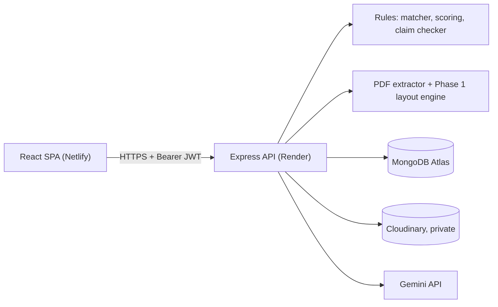

# CareerCraft AI

Tailor one master resume to any job description **without inventing anything**, keep the original
resume layout, and track every application that follows.

- **Live app:** <https://careercraft-ai-dash.netlify.app>
- **API health:** <https://careercraft-ai-pmk4.onrender.com/api/health>
- **Status:** Phases 1–6 implemented. Phase 7 (AI interview preparation) is planned and **not implemented**.

## Main features

- **Accounts** – register, sign in, sign out (revokes all sessions); JWT sessions.
- **Master resume** – upload a PDF; structured extraction (pdf.js); template compatibility check;
  private storage in Cloudinary; preview, signed download, replace (previous version kept as a private
  backup), delete.
- **Job description analysis** – one Gemini call extracts requirements; deterministic rules classify
  each one against resume evidence (direct match, experience-supported, related, missing) and compute
  a transparent weighted match score; history with staleness detection.
- **Evidence-checked tailoring** – AI rewording of the summary and bullets plus rule-based reordering;
  a claim checker blocks unsupported technologies, numbers, seniority, ownership and identity
  changes; meaning changes need explicit review; every decision is audited; approval freezes the
  content; PDFs are generated with the measured Phase 1 layout engine and validated by reading them back.
- **Job application tracker** – controlled status pipeline with undo and permanent history, Kanban
  board, links to analyses and approved resumes, interview rounds (reschedule/cancel history),
  follow-ups, dashboard analytics, search/filters/sorting/pagination, CSV export.

## Technology stack

| Layer | Technologies |
|---|---|
| Frontend | React 19, React Router 7, Vite 8, Tailwind CSS 4, axios, lucide-react, react-hot-toast |
| Backend | Node.js ≥ 20.19, Express 5, Mongoose 9, zod 4, jsonwebtoken, bcryptjs, helmet, cors, express-rate-limit, multer, morgan |
| PDF | pdfjs-dist (extraction), pdf-lib + @pdf-lib/fontkit (generation), Carlito fonts (SIL OFL) |
| AI | Google Gemini via `@google/genai` (backend only) |
| Data & files | MongoDB Atlas, Cloudinary (private raw assets) |
| Hosting | Netlify (frontend), Render (backend) |
| Tests | node:test, supertest |

## Architecture overview



The AI proposes; JavaScript rules decide. Details in [docs/02-system-architecture.md](docs/02-system-architecture.md).

## Screenshots

_Add screenshots here (dashboard, job analysis, tailoring review, application board). Use fictional
data only – never a real resume._

## Documentation

| Document | Topic |
|---|---|
| [docs/README.md](docs/README.md) | index |
| [01 Project overview](docs/01-project-overview.md) | problem, users, features, journey, stack |
| [02 System architecture](docs/02-system-architecture.md) | components and data flows |
| [03 Phase-wise features](docs/03-phase-wise-features.md) | business logic per phase |
| [04 Database design](docs/04-database-design.md) | models, indexes, ownership, retention |
| [05 Backend API reference](docs/05-backend-api-reference.md) | every endpoint |
| [06 AI architecture](docs/06-ai-architecture.md) | prompts, structured output, retries, safeguards |
| [07 Frontend architecture](docs/07-frontend-architecture.md) | routes, state, UI flows |
| [08 Security and privacy](docs/08-security-and-privacy.md) | controls and known gaps |
| [09 Testing strategy](docs/09-testing-strategy.md) | test suite and results |
| [10 Deployment guide](docs/10-deployment-guide.md) | Netlify, Render, Atlas, Cloudinary, Gemini |
| [11 Local development setup](docs/11-local-development-setup.md) | run it locally |
| [12 Technical interview guide](docs/12-technical-interview-guide.md) | presenting the project, Q&A |
| [13 Future roadmap](docs/13-future-roadmap.md) | not yet implemented |

## Local setup (quick start)

Prerequisites: Node.js 20.19+ / 22.12+, npm, a local MongoDB (or Atlas).

```bash
git clone https://github.com/prashanthkumarreddyA/CareerCraft-AI.git
cd CareerCraft-AI
git config core.hooksPath .githooks          # privacy pre-commit hook

cd backend
npm install
cp .env.example .env                         # fill in MongoDB, JWT, Gemini, Cloudinary values
npm run dev                                  # http://localhost:5000/api/health

cd ../frontend                               # second terminal
npm install
cp .env.example .env.local                   # VITE_API_URL=http://localhost:5000/api
npm run dev                                  # http://localhost:5180
```

Tests: `cd backend && npm test` (needs local MongoDB; no external services are called).
Full guide: [docs/11-local-development-setup.md](docs/11-local-development-setup.md).

## Privacy

Resumes, `.env` files and research outputs are git-ignored and blocked by `.githooks/pre-commit`.
Secrets live only in backend environment variables; `VITE_*` variables are public. See
[docs/08-security-and-privacy.md](docs/08-security-and-privacy.md).

## Fonts

PDFs use **Carlito** (SIL Open Font License, `backend/assets/fonts/OFL.txt`), metric-compatible with
Calibri so line breaks match the original layout.
