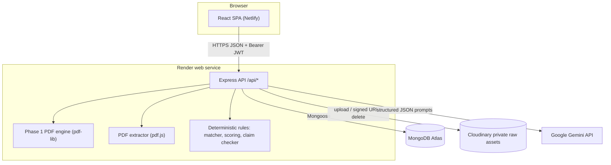

# 01 · Project overview

## What CareerCraft AI is

CareerCraft AI is a full-stack web application that helps a job seeker **tailor one master resume
to a specific job description without inventing anything**, keep the result in the original resume
layout, and **track the job applications** that follow.

- Live frontend: <https://careercraft-ai-dash.netlify.app>
- Live API: <https://careercraft-ai-pmk4.onrender.com/api/health>
- Source: <https://github.com/prashanthkumarreddyA/CareerCraft-AI>

> Inside the code the service is still called `ai-resume-builder-api` (see `backend/package.json`
> and the health endpoint). "CareerCraft AI" is the product name used for the deployment.

## The problem it solves

Applying to many jobs usually means rewriting the same resume again and again. Two things go wrong:

1. **Formatting breaks.** Editing a Word/PDF resume by hand, or pasting it into an online builder,
   changes fonts, spacing and page breaks.
2. **AI tools hallucinate.** Generic "AI resume writers" happily add skills, metrics or seniority the
   candidate never had. That is risky in interviews and background checks.

CareerCraft AI treats the **master resume as the single source of truth**:

- It measures the original PDF layout once (Phase 1) and regenerates PDFs in exactly that layout.
- It analyses a job description against the resume's actual evidence (Phase 4).
- It lets the AI propose wording only, then checks every proposal against the resume with
  deterministic JavaScript rules before the user can accept it (Phase 5).
- It tracks applications, interviews and follow-ups, linked to the analysis and the tailored resume
  that was actually sent (Phase 6).

## Target users

- Individual job seekers (one account = one person, one master resume).
- Primarily software developers. The skill taxonomy (`backend/services/job-analysis/skill-taxonomy.js`,
  181 entries) and the PDF template are tuned for a one-column technical resume.
- The PDF template reproduces **one specific layout** (`classic-v1`, US Letter, Calibri/Carlito).
  Resumes with other layouts can be uploaded and analysed, but are flagged as not template-compatible.

## Main features (implemented)

| Area | What the user can do | Phase |
|---|---|---|
| Accounts | register, sign in, sign out (revokes all sessions), stay signed in for 7 days by default | 3 |
| Master resume | upload a PDF (≤ 5 MB), see extracted content and a PDF preview, replace it (old file kept as a private backup), download, delete | 3 (+ backups later) |
| Job analysis | paste a job description; get must-have / preferred / optional keywords, each classified against resume evidence, and a transparent weighted match score; keep a history | 4 |
| Tailoring | create tailored versions: AI-reworded summary and bullets plus rule-based reordering of skills and bullets; review each change side by side; accept, reject or edit; approve; generate a validated PDF | 5 |
| Application tracker | track applications with a status pipeline, Kanban board, interviews, follow-ups, dashboard analytics, search/filters and CSV export; link each application to its analysis and tailored resume | 6 |

Not implemented: emails/notifications, DOCX export, a resume editor for the master resume, interview
preparation (Phase 7). See [13-future-roadmap.md](13-future-roadmap.md).

## End-to-end user journey

```mermaid
flowchart LR
    A["Register / sign in"] --> B["Upload master resume PDF"]
    B --> C["Review extracted content + preview"]
    C --> D["Paste a job description"]
    D --> E["Analysis: keywords, evidence, match %"]
    E --> F["Create tailored version"]
    F --> G["Review AI + rule proposals"]
    G --> H["Approve content"]
    H --> I["Generate validated PDF"]
    E --> J["Track this job"]
    I --> J
    J --> K["Move through Saved → Applied → Interview → …"]
    K --> L["Interviews, follow-ups, dashboard, CSV"]
```

1. **Sign up** at `/register`. A JWT is stored in the browser.
2. **Upload the master resume** at `/master-resume`. The backend extracts structured data (name,
   summary, skills, roles, bullets, projects, education, achievements), checks it against the template
   and stores the original PDF privately in Cloudinary.
3. **Analyse a job** at `/job-analysis`. Gemini extracts requirements; backend rules decide whether
   each one is a direct match, experience-supported, related or missing, and compute the score.
4. **Tailor** from the analysis page ("Create tailored version"). Gemini proposes rewrites of the
   summary and bullets; the claim checker blocks anything not supported by the resume; skills and
   bullet order are proposed by rules. The user reviews every change at `/tailored-resumes/:id`.
5. **Approve and generate the PDF.** The approved content is frozen (hashed), rendered with the
   Phase 1 engine, re-read and compared before it is stored privately.
6. **Track the application** ("Track this job") at `/applications`: status pipeline, Kanban board,
   interviews, follow-ups and the dashboard on `/`.

## Technology stack

| Layer | Technology | Why it is used here |
|---|---|---|
| Frontend | React 19, React Router 7 | component model, client-side routing for an SPA on static hosting |
| | Vite 8 | fast dev server (port 5180) and production build |
| | Tailwind CSS 4 (`@tailwindcss/vite`) | utility CSS without a component library |
| | axios | one HTTP client with interceptors for auth and error normalisation |
| | lucide-react, react-hot-toast | icons and toast notifications |
| Backend | Node.js ≥ 20.19 (Render uses 22), Express 5 | simple HTTP API; Express 5 forwards async errors to the error handler |
| | Mongoose 9 | schemas, validation and indexes for MongoDB |
| | zod 4 | request validation and validation of AI answers |
| | jsonwebtoken, bcryptjs | stateless sessions (HS256) and password hashing |
| | helmet, cors, express-rate-limit, morgan | security headers, origin allow-list, rate limits, request logs |
| | multer (memory storage) | PDF uploads without touching the disk |
| | pdfjs-dist (legacy build) | text, font and coordinate extraction from PDFs |
| | pdf-lib + @pdf-lib/fontkit | PDF generation with embedded Carlito fonts |
| | @google/genai | official Gemini SDK (backend only) |
| | cloudinary | private file storage with signed URLs |
| Data | MongoDB Atlas (production) / local MongoDB (development, tests) | document storage; resumes and histories fit naturally as documents |
| Tests | `node:test`, supertest | built-in Node test runner; HTTP tests against the real app factory |
| Research | Python + PyMuPDF (`research/phase1/validate.py`) | one-off geometric/visual validation of the template engine |

## External services

| Service | Used for | Called from |
|---|---|---|
| **Netlify** | hosts the static frontend build | browser |
| **Render** (free web service) | runs the Express API | — |
| **MongoDB Atlas** | stores users, resumes, analyses, tailored versions, applications | backend |
| **Cloudinary** | stores master resume PDFs, backups and generated PDFs as private `raw/authenticated` assets | backend only |
| **Google Gemini API** | job description analysis and wording proposals (structured JSON) | backend only |

## High-level architecture

The browser never talks to MongoDB, Cloudinary or Gemini directly. Continue with
[02-system-architecture.md](02-system-architecture.md).
