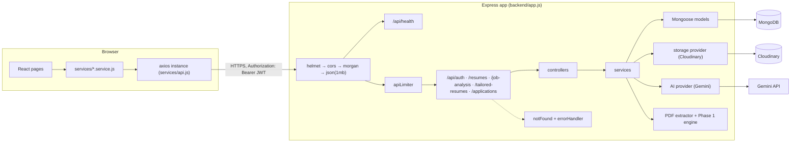
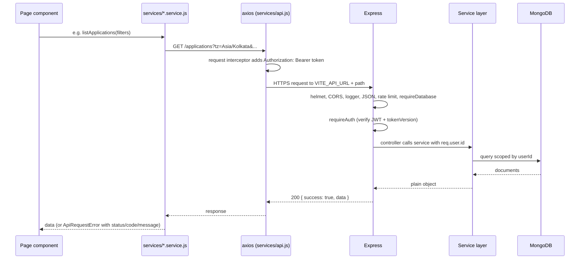
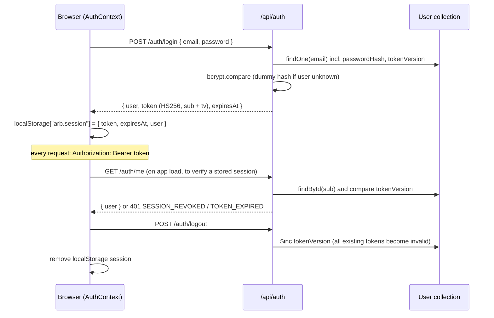
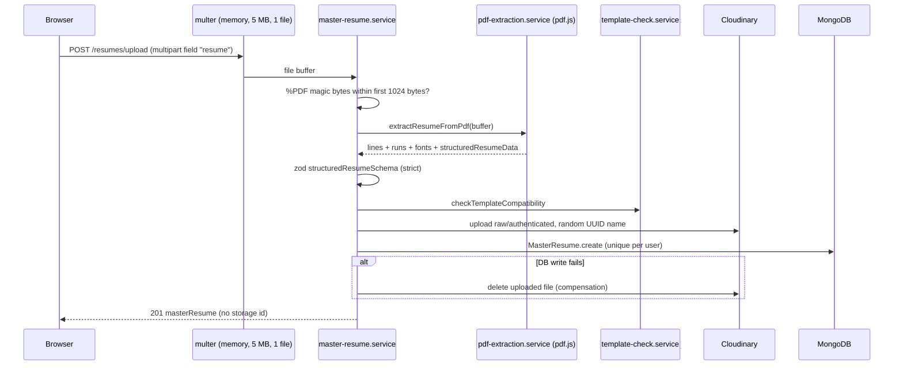
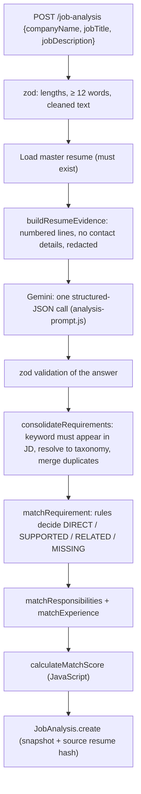
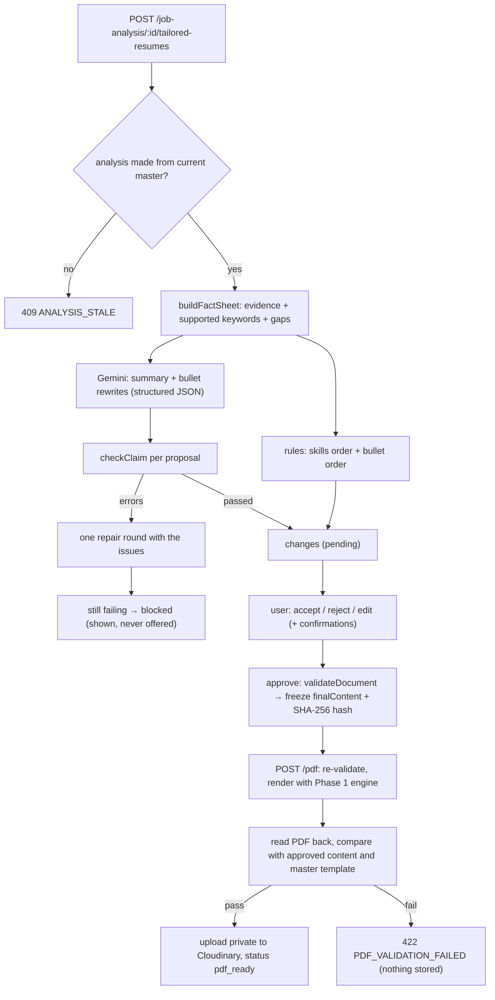
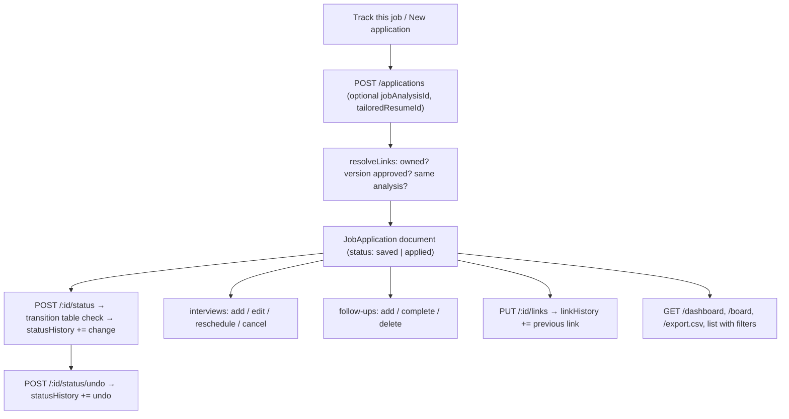
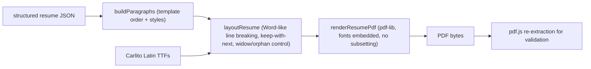

# 02 · System architecture

This document explains how the pieces fit together. Feature rules are in
[03-phase-wise-features.md](03-phase-wise-features.md); endpoint details in
[05-backend-api-reference.md](05-backend-api-reference.md).

## 1. Overall system

## 2. Backend architecture

### Layers

| Layer | Folder | Responsibility | Rule of thumb |
|---|---|---|---|
| Entry | `server.js` | checks env (`checkEnvironment`), starts HTTP server, connects MongoDB, graceful shutdown on SIGTERM/SIGINT | no business logic |
| App factory | `app.js` | `createApp({ storage, ai })` wires middleware and routes; dependencies are injectable (tests pass fakes) | no I/O at import time |
| Routes | `routes/*.routes.js` | URL → middleware chain → controller | `requireAuth`, `validateBody(schema)`, limiters |
| Controllers | `controllers/*.js` | read `req`, call a service, shape `{ success, data }` | thin |
| Services | `services/**` | business rules, ownership scoping, DB writes, AI and storage calls | every query filters by `userId` |
| Models | `models/*.js` | Mongoose schemas and indexes | — |
| Validators | `validators/*.js` | zod schemas for bodies/queries | strict objects (unknown keys rejected) |
| Utilities | `utils/ApiError.js`, `utils/logger.js` | typed client-safe errors, leveled logger | messages never contain secrets or resume text |

### Middleware order (`backend/app.js`)

1. `app.disable('x-powered-by')`, `trust proxy` = `TRUST_PROXY` (1 on Render) so rate limits see the client IP.
2. `helmet()` – security headers.
3. `cors(corsOptions)` – only origins from `CLIENT_URL` (see [08](08-security-and-privacy.md)).
4. `requestLogger` (morgan) – method, path without query string, status, size, duration.
5. `express.json({ limit: '1mb' })`.
6. `/api/health` – **outside** the rate limiter (the frontend polls it while Render wakes up).
7. `/api` → `apiLimiter` → `routes/index.js`, which adds `requireDatabase` (503 if MongoDB is not connected) per router.
8. `notFound` → `errorHandler`.

### Error handling

All errors become one envelope: `{ "success": false, "error": { "code", "message", "details"? } }`.

- `ApiError` (status + code + safe message) is thrown by services.
- `errorHandler` maps body-parser errors (`INVALID_JSON`, `PAYLOAD_TOO_LARGE`), multer errors
  (`FILE_TOO_LARGE`, …), Mongoose `CastError`/`ValidationError` (field names only, never values),
  duplicate keys (409 `DUPLICATE`) and MongoDB connectivity errors (503 `DATABASE_UNAVAILABLE`).
- Anything else is a 500 `INTERNAL_ERROR` with a generic message; only 5xx are logged, without stack
  traces in production.
- Express 5 forwards rejected promises from async handlers to `errorHandler`, so controllers do not
  need `try/catch`.

### Logging

`utils/logger.js` writes JSON lines in production (searchable in Render) and readable text in
development; nothing in tests. Request logs strip query strings and never include bodies. AI logs
contain task name, model, attempt count, latency and error kind – never prompts or answers.

### Environment configuration

`config/env.js` loads `backend/.env` locally (Node's built-in `process.loadEnvFile`; Render injects
variables instead), parses typed values into a frozen `config` object, and `checkEnvironment()`:

- **refuses to start in production** without `CLIENT_URL`, `MONGODB_URI`, `JWT_SECRET`,
  `GEMINI_API_KEY`, `GEMINI_MODEL`, `CLOUDINARY_CLOUD_NAME`, `CLOUDINARY_API_KEY`,
  `CLOUDINARY_API_SECRET`;
- warns about missing optional variables, short `JWT_SECRET`, localhost origins in production, and
  `CLIENT_URL` entries that had to be reduced to their origin.

Full variable list: [10-deployment-guide.md](10-deployment-guide.md#environment-variables).

### MongoDB connection

`config/db.js` connects in the background with exponential back-off (1 s → 30 s), so the HTTP server
and its health endpoint stay up while Atlas is unreachable. `requireDatabase` fails fast with 503
instead of letting Mongoose buffer queries. `strictQuery` is enabled.

### Dependency injection for external services

`createApp({ storage, ai })` takes two providers:

- **storage** – `cloudinaryStorage` (`services/cloudinary.service.js`) with `uploadPdf`, `deleteFile`,
  `getSignedUrl`, `fetchFile`. Tests use an in-memory fake (`tests/helpers/fakeStorage.js`).
- **ai** – `getDefaultAiProvider()` (`services/ai/index.js`) returns the Gemini provider when
  `GEMINI_API_KEY` and `GEMINI_MODEL` are set, otherwise an "unconfigured" provider that answers
  503 `AI_NOT_CONFIGURED`. Tests use `tests/helpers/fakeAi.js`.

## 3. Frontend architecture (summary)

React SPA with React Router data routers, two context providers (backend health, authentication),
page-level state with hooks, and one axios instance. Details: [07-frontend-architecture.md](07-frontend-architecture.md).

## 4. Frontend-to-backend request flow

On errors the response interceptor converts everything into an `ApiRequestError`
(`status`, `code`, `message`, `details`, `isNetworkError`, `isTimeout`). A 401 on an authenticated
request ends the local session.

## 5. Authentication flow

## 6. Resume upload and extraction flow

Replacement (`PUT /resumes/master`) uploads the new file first, then atomically swaps the record
(conditional on the previous file id, so two concurrent replaces cannot both win) and moves the old
file into `backups` instead of deleting it.

## 7. AI job description analysis flow

## 8. Resume tailoring and PDF generation flow

## 9. Job application tracking flow

All application changes are single-document atomic updates guarded by a `revision` number
(optimistic concurrency), so no multi-document transactions are needed. This matters because the
local development MongoDB is a standalone server, where transactions are not available.

## 10. PDF generation architecture

- The engine lives in `research/phase1/resume-template.mjs`; `backend/pdf/resume-template.mjs` is a
  **byte-identical copy** (a test compares the two files).
- `backend/services/tailoring/resume-renderer.js` only feeds data into the engine and reads its layout
  output (`layoutCheck` for page count, overflow and per-paragraph line counts).

## 11. Cloudinary integration

- Assets are uploaded with `resource_type: raw` and `type: authenticated`: no public delivery URL exists.
- Public ids are random UUIDs under `resumes/master/<userId>/` and `resumes/customized/<userId>/`;
  file names (which may contain a person's name) never appear in storage paths.
- Access is either streamed by the backend after an ownership check (`/file`, `/pdf`, with SHA-256
  integrity verification), or via a **signed URL** valid for `SIGNED_URL_TTL_SECONDS` (default 300 s).
- Storage ids are never returned to the browser.
