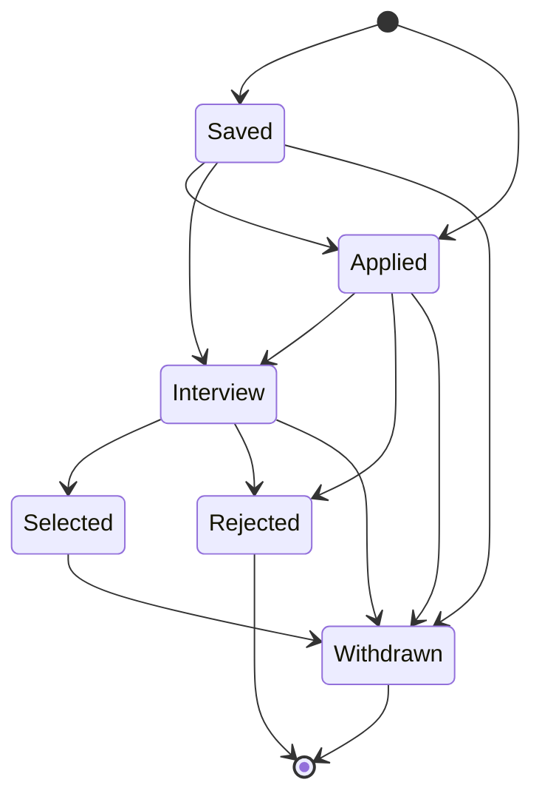

# 03 · Phase-wise features

Each phase builds on the previous one. Business rules are described here; data structures in
[04-database-design.md](04-database-design.md), endpoints in [05-backend-api-reference.md](05-backend-api-reference.md).

---

## Phase 1 – Resume PDF extraction and template engine

**Location:** `research/phase1/` (frozen research baseline) → reused by the backend.

### Why this phase exists

The original resume was exported from Microsoft Word. The goal was to generate tailored PDFs that look
exactly like it. `research/phase1/PHASE1-REPORT.md` documents why the PDF could **not** be edited in
place:

- the embedded fonts are **subsets** (characters such as `K X Y Z # &` have no outlines in the
  regular face), so new words could not be drawn;
- Word positioned every line separately, so changing text means re-flowing the whole document;
- pdf-lib cannot edit existing content streams (only draw on top).

The chosen approach: **measure the layout once and re-implement it** as a small layout engine.

### PDF text extraction (`extract.mjs` → `backend/services/pdf-extraction.service.js`)

1. pdf.js (`pdfjs-dist` legacy build) reads every text item with its font, size and position.
2. Items within 1.0 pt of the same baseline form a **line**; lines are split into **runs** by
   bold/italic (derived from the font name).
3. Lines are merged into **paragraphs** (new paragraph on headings, bullets, bold/italic starts, a
   baseline gap > 15 pt, or a size change).
4. Paragraphs are classified using the template's typography:
   - section heading: bold, 11.5–14 pt, uppercase, single run (e.g. `PROFESSIONAL SUMMARY`);
   - entry header: line starting with a bold run (company / project / institution);
   - role/degree line: line starting with an italic run;
   - bullet: line starting with `•`.
5. The result is the **structured resume JSON** plus the raw line dump.

Extraction errors are typed (`INVALID_PDF`, `PDF_ENCRYPTED`, `NO_TEXT` for scanned PDFs,
`UNSUPPORTED_LAYOUT`) and their messages never contain resume text.

### Resume JSON structure

Validated by `backend/validators/resume.schema.js` (strict: unknown keys are rejected).

```json
{
  "personalInfo": { "fullName": "Alex Morgan", "location": "…", "phone": "…", "email": "…", "linkedin": "…", "github": "…", "other": [] },
  "headline": "Full Stack Developer | TypeScript | Cloud",
  "summary": "Full Stack Developer with 4+ years of experience …",
  "technicalSkills": [{ "category": "Backend", "items": ["Node.js", "Express.js", "RESTful APIs"] }],
  "experience": [{ "company": "…", "location": "…", "title": "Senior Software Engineer", "startDate": "Jan 2024", "endDate": "Present", "bullets": ["…"] }],
  "projects": [{ "name": "…", "technologies": ["…"], "bullets": ["…"] }],
  "education": [{ "institution": "…", "location": "…", "degree": "…", "score": "…", "startDate": "…", "endDate": "…" }],
  "achievements": ["…"],
  "sectionOrder": [{ "key": "summary", "heading": "PROFESSIONAL SUMMARY" }]
}
```

(All example values are fictional; the test fixture `backend/tests/fixtures/sample-resume.json` has the same shape.)

### Template analysis

The measured template is `RESUME_TEMPLATE` (`id: 'classic-v1'`) in `resume-template.mjs`:

| Property | Value |
|---|---|
| Page | US Letter, 612 × 792 pt |
| Margins | 72 pt (1 inch) on every side; content width 468 pt |
| Name | 18 pt bold, centred |
| Contact lines, headline | 10.5 pt, centred (headline bold, 4 pt before) |
| Section heading | 12 pt bold, 10 pt before, 3.85 pt after, rule 0.75 pt thick, 3 pt below the baseline |
| Body / bullets | 10.5 pt; bullets indented 12 pt; literal `• ` characters |
| Entry header | 10.5 pt, 6 pt before, keep-with-next |
| Font metrics | ascent 1950/2048, descent 550/2048 (line height ≈ 1.2207 em) |

`backend/services/template-check.service.js` checks an uploaded PDF against this template (page size,
font families Calibri/Carlito, sizes 10.5/12/18, required sections summary/skills/experience/education,
no unknown headings). Incompatible resumes are stored but flagged (`templateCompatibility.issues`).

### Font handling and layout calculations

- **Carlito** replaces Calibri: it is open-licensed (SIL OFL) and metric-compatible (same character
  widths), so lines break in the same places. Calibri cannot be redistributed or installed on Render.
- Pre-built **Latin subsets** of Carlito (`*.latin.ttf`) are embedded **without** pdf-lib's own
  subsetting: the report records that `subset: true` silently dropped glyph outlines (text extracted
  fine but rendered blank), which only a visual check revealed.
- `layoutResume()` re-implements Word's paragraph model:
  - line height = size × (ascent + descent); first baseline = top + size × ascent;
  - space between paragraphs = max(previous spaceAfter, next spaceBefore) + border;
  - breaks at spaces and after in-word hyphens (no automatic hyphenation);
  - **keep-with-next** for headings, entry headers and role lines;
  - **widow/orphan control**: never a single line of a paragraph alone on a page;
  - space before is suppressed at the top of a page.

### PDF generation using pdf-lib

`renderResumePdf()` measures text with fontkit faces, lays out pages, embeds only the faces used,
then draws text runs and section rules. Kerning and ligatures are disabled to match measurement.

### Validation and page limits

- `research/phase1/validate.py` (PyMuPDF) compared the original Word PDF with a regenerated one:
  per the report, **81 of 81 lines identical** in text and line breaks, baseline Δ ≤ 0.61 pt,
  line-end Δ ≤ 0.56 pt, no overlaps, no text outside margins. This script is a development tool and
  is not part of the automated test suite.
- In the application the maximum is **2 pages** (`MAX_PAGES` in `resume-renderer.js`). Fonts and
  spacing are never shrunk to fit; content that does not fit is rejected.

### Why the engine is frozen

Every guarantee about "same layout as the original" depends on the measured numbers and the exact
line-breaking algorithm. Therefore:

- `research/phase1/resume-template.mjs` is never modified;
- `backend/pdf/resume-template.mjs` is a byte-identical copy, asserted by `tests/tailored-pdf.test.js`;
- the backend extractor must produce the same output as `research/phase1/extract.mjs`
  (`tests/extraction.test.js`).

### Limitations

- Only one layout (`classic-v1`) can be regenerated. Other designs are flagged, not cloned.
- Carlito glyph shapes are near-identical to Calibri but not pixel-identical.
- Characters outside the Carlito Latin subsets cannot be printed; such text is rejected
  (`UNSUPPORTED_CHARACTER`).
- No DOCX export (mentioned as optional in the Phase 1 report; not implemented).

---

## Phase 2 – Application foundation

- **Two independent packages**: `frontend/` (Vite) and `backend/` (Express); there is no root
  `package.json`.
- **Ports**: frontend dev 5180, preview 4180 (both `strictPort`), backend 5000.
- **Security baseline**: helmet, CORS allow-list, JSON body limit 1 MB, general rate limit, typed
  errors without internals, environment checks that stop a misconfigured production start.
- **Health and cold starts**: `GET /api/health` reports database and AI configuration status; the
  frontend's `useBackendHealth` retries for up to 90 s and shows "Waking server…".
- **Privacy tooling**: `.gitignore` excludes resumes, `.env` files and research outputs;
  `.githooks/pre-commit` blocks such files and credential-looking content even with `git add -f`
  (enable with `git config core.hooksPath .githooks`).
- **Deployment**: Netlify (frontend, `frontend/netlify.toml`) and Render (backend, `render.yaml`).

---

## Phase 3 – Authentication and master resume management

### Accounts

| Action | Behaviour |
|---|---|
| Register | name (1–100), email (lower-cased, unique), password 8–128 chars; bcrypt hash (cost `BCRYPT_ROUNDS`, default 12); returns a JWT |
| Login | constant-time-ish check: an unknown email is compared against a dummy hash so timing does not reveal registered emails |
| JWT | HS256, claims `sub` (user id) and `tv` (token version), expiry `JWT_EXPIRES_IN` (default 7 days) |
| Logout | increments `tokenVersion`: **every** token issued before becomes invalid (stateless JWTs cannot be revoked one by one) |
| Current user | `GET /auth/me` verifies signature, expiry, and that `tv` equals the stored `tokenVersion` |

Login and register share a limiter of 20 requests per 15 minutes per IP.

### Master resume

One master resume per user (unique index on `userId`).

- **Upload**: multer keeps the file in memory (max `MAX_UPLOAD_SIZE_MB`, default 5 MB, one file, field
  `resume`). The MIME type is checked and the `%PDF` signature must appear in the first 1024 bytes.
  The file is extracted, validated against the resume schema, checked against the template, stored in
  Cloudinary, and recorded with its SHA-256 hash.
- **Preview**: `GET /resumes/master/file` streams the PDF to its owner after re-checking the hash
  (`FILE_INTEGRITY_ERROR` on mismatch). The frontend shows it through a temporary `blob:` URL.
- **Download**: `GET /resumes/master/download-url` returns a signed Cloudinary URL that expires after
  `SIGNED_URL_TTL_SECONDS` (default 300).
- **Replace**: the new file is uploaded and extracted first; the record is swapped atomically; the
  previous PDF is **kept as a private backup** (`backups[]`) and can be downloaded via
  `/resumes/master/backups/:backupId/file` or `/download-url`.
- **Delete**: deletes every backup file, the current file and the record (storage first, so a storage
  failure leaves the record for a retry).
- **Isolation**: all routes act on `req.user.id`; there is no way to address another user's resume.

---

## Phase 4 – AI job description analysis

### Submitting a job description

`POST /api/job-analysis` with `companyName` (≤ 120), `jobTitle` (≤ 150) and `jobDescription`
(80–20,000 characters, at least 12 words; control characters removed, blank lines collapsed).
A master resume is required. The AI limiter allows 30 analyses/tailorings per user per hour.

### What Gemini does

One structured-JSON call (`services/job-analysis/analysis-prompt.js`) receives:

- the job title and job description, inside `<job_description>` tags;
- the resume as **numbered evidence lines** (`[exp.1.3] (experience) Designed and built 30+ RESTful APIs…`)
  built by `resume-evidence.js` – no contact details, no company or school names, emails/URLs/phones
  and the person's name redacted.

It returns: role summary, seniority, required years (with the verbatim quote), education, up to 120
requirements (`term`, `normalizedName`, `category`, `importance`, the AI's own `classification`,
`evidenceIds`, `relatedSkill`, `rationale`), up to 40 responsibilities and soft skills.

### What the backend decides (the AI only proposes)

`services/job-analysis/requirement-matcher.js`:

1. **Keyword must exist in the JD.** A term that does not appear in the job description text is
   dropped (counted in a warning).
2. **Normalisation against the taxonomy** (181 curated entries with aliases, parent/child and
   related/family links). A JD phrase is resolved to the known skills it consists of when the rest
   is generic ("NestJS framework" → NestJS; "Node.js/NestJS" → Node.js + NestJS; "AWS (Lambda, S3)"
   → AWS Lambda + AWS S3). "GraphQL subscriptions" stays its own requirement.
3. **Duplicates merge** (ReactJS = React.js = React), keeping the highest importance.
4. **Classification:**

| Classification | Credit | Who decides | Rule |
|---|---|---|---|
| `DIRECT_MATCH` | 1.00 | rules | the resume evidence names the technology, an alias, or a more specific part of it (AWS EC2 proves AWS; AWS does not prove EC2) |
| `EXPERIENCE_SUPPORTED` | 0.85 | AI, verified | **concepts/practices only** (e.g. API design); accepted only with evidence ids that exist |
| `RELATED_EXPERIENCE` | 0.30 | AI, verified | concepts with valid evidence where the AI judged partial support; responsibilities partly done; years of experience within one year of the requirement |
| `MISSING` | 0 | rules | not evidenced |

**Concrete technologies are either named (DIRECT_MATCH) or MISSING.** A related technology the
resume does name (Express.js for NestJS, AWS EC2 for AWS Lambda) is shown only as context
(`relatedSkills`, `relatedEvidence`) and earns no credit. The AI's own "direct" or "experience" claim
for an unnamed technology is overridden and recorded in `adjustments`.

5. **Responsibilities** are kept only if most of their words appear in the JD, and can only be
   supported by experience/project evidence (not the skills list).
6. **Years of experience** are computed from the experience section's dates (overlaps merged) and are
   scored only when the JD text actually states the number.

### Matching score (`services/job-analysis/scoring.js`)

```
coverage(group) = average credit of the items in the group
score           = Σ weight(group) × coverage(group) ÷ Σ weight(group)   (groups present in the JD only)
weights         = must-have 50 · preferred 20 · optional 5 · responsibilities 15 · years of experience 10
```

Worked example with the actual formula:

| Group | Items | Credits | Coverage | Weight |
|---|---|---|---|---|
| Must-have | Node.js direct, MongoDB direct, Docker missing, API design experience-supported | 1 + 1 + 0 + 0.85 = 2.85 | 71.3 % | 50 |
| Preferred | GraphQL direct, NestJS missing | 1 + 0 = 1 | 50 % | 20 |
| Optional | (none in this JD) | – | excluded | – |
| Responsibilities | one supported, one related | 0.85 + 0.3 = 1.15 | 57.5 % | 15 |
| Experience | 5 years asked, 4.5 found (within a year) → related | 0.3 | 30 % | 10 |

Score = (50 × 0.713 + 20 × 0.50 + 15 × 0.575 + 10 × 0.30) ÷ 95 = 57.275 ÷ 95 ≈ **60 %**.

The response also includes a per-group breakdown, must-have coverage, the list of missing must-haves,
the formula text and a disclaimer that this is **not** an ATS score.

### History and staleness

Each analysis is a snapshot (`JobAnalysis`), including the SHA-256 of the master resume file it was
computed from. When the master resume is replaced, older analyses are returned with `stale: true` and
cannot be used for new tailored versions (409 `ANALYSIS_STALE`). An analysis cannot be deleted while
tailored versions exist (`JOB_ANALYSIS_HAS_VERSIONS`) or while a job application references it
(`LINKED_TO_APPLICATION`).

---

## Phase 5 – Resume tailoring and PDF generation

### Scope of changes

| Part of the resume | Allowed change |
|---|---|
| Summary | reworded (AI or user) |
| Technical skills | **re-ordered only** (groups and items); nothing added, removed or renamed |
| Experience bullets | reworded and re-ordered **within the same role**; the number of bullets stays the same |
| Everything else (contact details, headline, role titles/companies/dates, projects, education, achievements, section order) | **locked**, verified structurally (`verifyLockedFields`) |

### Creating a version

`POST /api/job-analysis/:id/tailored-resumes` (AI limiter applies):

1. Checks that the analysis belongs to the user and was made from the **current** master resume.
2. Builds the **fact sheet** (`services/tailoring/fact-sheet.js`): numbered evidence, supported
   requirements, gaps (missing keywords), the locked professional identity (from the headline, e.g.
   "Full Stack Developer"), designations used in the resume, and skills actually used in jobs/projects.
3. Asks Gemini for summary and bullet rewrites (`tailoring-prompt.js`, 12 rules).
4. Discards rewrites that only delete words (`isDeletionOnly`).
5. Runs the **claim checker** on every proposal; failures go back to Gemini once with the issues
   (repair round); anything still failing is **blocked** – stored and shown, never offered.
6. Adds rule-based proposals: skills order and bullet order per role (`ordering.js`; weights must-have 3,
   preferred 2, optional 1; stable sort, so ties keep their original order).
7. Stores a new `TailoredResume` with `versionNumber` = next number for that analysis.

### Claim checker (`services/tailoring/claim-checker.js` + `meaning-checker.js`)

Severity `error` blocks AI proposals; for the user's own edits most errors can be overridden with an
explicit, recorded confirmation. Severity `review` never passes silently. Severity `warning` is
informational.

| Code | Severity | Catches |
|---|---|---|
| `EMPTY_TEXT`, `TEXT_TOO_LONG` (bullet 420, summary 1100), `MULTILINE` | error (not overridable) | shape |
| `UNSUPPORTED_CHARACTER` | error (not overridable) | glyphs the embedded fonts cannot draw |
| `UNKNOWN_EVIDENCE`, `EVIDENCE_REQUIRED` | error | AI cited ids that do not exist / no evidence |
| `EVIDENCE_OUT_OF_SCOPE` | error | a bullet using another role's facts |
| `GAP_KEYWORD` | error (not overridable) | adding a missing job keyword (e.g. NestJS when the resume only has Express.js) |
| `UNSUPPORTED_TECHNOLOGY`, `UNSUPPORTED_TERM` | error | technologies or capitalised names not in the cited evidence (also unknown tools) |
| `UNSUPPORTED_NUMBER`, `UNSUPPORTED_QUANTITY` | error | new or changed numbers (the decoration and unit must match: `40` ≠ `40+`, "12 minutes" ≠ "12 engineers"), vague quantities ("dozens") |
| `INFLATED_ROLE` | error | led, managed, owned, architected, spearheaded, mentored, expert, senior… not in the evidence |
| `OWNERSHIP_INFLATED` | error | "contributed to / assisted" turned into sole ownership |
| `IDENTITY_CHANGED` | error (not overridable) | summary no longer leads with the locked identity |
| `DESIGNATION_ADDED` | error | a designation the resume does not use (e.g. "Backend Developer") |
| `SUMMARY_DETAIL_REMOVED`, `SUMMARY_TOO_SHORT` (< 80 %) | error (AI only) | AI summary dropping facts to get shorter |
| `MEANING_CHANGED` | review | a different kind of action (built → optimized, new outcomes like "ensuring") |
| `UNVERIFIED_ACTION` | review | a bullet starting with a verb the checker cannot compare |
| `SKILL_LIST_ONLY` | review | summary adds a skill that only the skills list names, never a job or project |
| `REMOVED_DETAIL`, `ACTION_REMOVED`, `LENGTH_GROWTH`, `MUCH_SHORTER` | warning | details dropped, length changes |

### Review workflow and audit history

Each change has a `decision`: `pending`, `accepted`, `rejected` or `edited`.

- **Accept**: only proposals that pass the claim checker (re-run with the current rules). If the
  proposal has `review` issues, the request must include `confirmReview: true`; the confirmation is
  stored on the change and in its history (`accepted_after_review`).
- **Accept all**: accepts pending proposals that passed and need no review.
- **Edit**: the user's own text is checked against the **whole allowed scope** (its role for bullets,
  the whole resume for the summary). Errors require `confirmOverride: true` except the non-overridable
  ones; review issues require `confirmReview: true`. History records original text, proposed text,
  edited text, all issues and both confirmations (`edited` / `edited_with_override`).
- **Reset / reject** return to the original text.
- Decisions carry `expectedRevision`; a stale tab gets 409 `REVISION_CONFLICT`.

### Keyword coverage and layout feedback

- **Keyword coverage** (`content-builder.js → keywordCoverage`) counts, among keywords the resume
  already evidences, how many appear literally in the resume text before vs after tailoring. Gaps are
  listed separately and never added.
- **Layout report** runs the Phase 1 engine without writing a PDF: page count (max 2), overflowing
  lines, structural differences, and paragraphs that would grow by a line.

### AI suggestion vs verified change vs approved resume

| Stage | Meaning | Where |
|---|---|---|
| **AI suggestion** | text Gemini returned; untrusted | transient, in `generateTailoringProposals` |
| **Blocked suggestion** | failed the claim checker even after the repair round; visible for transparency, cannot be accepted | `TailoredResume.blocked[]` |
| **Verified change (proposal)** | passed the claim checker; waits for the user's decision | `changes[]` with `decision: pending` |
| **Decided change** | accepted (possibly after review), edited (possibly with override) or rejected | `changes[].decision` + `history[]` |
| **Approved resume** | all changes decided, `validateDocument` passed; content frozen in `finalContent` with a SHA-256 `contentHash` | `status: approved` |
| **PDF-ready resume** | the PDF was rendered from the frozen content, passed every check, and is stored privately | `status: pdf_ready`, `pdf.*` |

### Approval (`validateDocument`)

Blocks approval (`APPROVAL_BLOCKED`) when any of these hold: decisions pending, invalid re-ordering,
claims failing without a valid override, unconfirmed review issues, locked fields changed,
unprintable characters, or layout errors (more than 2 pages, overflow, structure differences). A
version made from an older master resume cannot be approved, printed or duplicated (409
`MASTER_CHANGED`).

### PDF generation and validation (`services/tailored-pdf.service.js`)

Only approved versions. Before anything is stored:

1. content hash matches; content equals what the recorded decisions produce;
2. `validateDocument` passes again on the frozen content;
3. render with the Phase 1 engine; page count ≤ 2;
4. **read the PDF back** with the Phase 3 extractor: every section must equal the approved content;
5. template check (`classic-v1`), same fonts/sizes, same left margin and headings as the master
   rendered by the same engine.

On success the PDF is uploaded to `resumes/customized/<userId>/`, the record moves to `pdf_ready`
(conditional on status and hash), and on a failed DB write the uploaded file is deleted again.
Downloads re-check the SHA-256.

### Versioning

- `versionNumber` is unique per (user, analysis); concurrent creation retries on duplicate-key errors.
- `duplicate` copies an approved or draft version into a new draft (decisions copied, proposals
  re-checked with the current rules).
- A version linked to a job application cannot be deleted (`LINKED_TO_APPLICATION`).

---

## Phase 6 – Job Application Tracker

### Applications

Fields: company, job title, location, employment type, salary range (min/max/currency/period),
experience requirement (min/max years + text), source + detail, job URL (http/https only), full job
description (≤ 20,000, stored in the application so it survives the posting), application date
(calendar date), notes. New applications start as **Saved** or **Applied** (Applied fills in today's
date if empty).

### Status pipeline



- Any other move returns 422 `INVALID_STATUS_TRANSITION` with the allowed targets
  (`TRANSITIONS` in `backend/models/JobApplication.js`).
- **Undo** reverts the latest change if the latest history entry is a change (not chainable). It is
  recorded as an `undo` entry; history is append-only.
- Entering Applied/Interview without a date fills in today **in the user's time zone**; undoing that
  change clears the date again unless the user edited it.
- The status write is conditional on both the revision and the status it was validated against.

### Kanban board

`/applications/board` shows six columns. Cards can be dragged (native HTML5 drag-and-drop); columns
that are not allowed targets are dimmed and refuse the drop. Every card also has a "Move to…" menu
(keyboard and touch). A toast offers Undo after each move. The board shows at most the 1,000 most
recently updated applications (`truncated: true` beyond that).

### Linking JobAnalysis and TailoredResume

- References only: no copies of analyses or resumes.
- A linked version must be **approved or PDF-ready** and belong to the linked analysis.
- Changing links appends the previous link (with its version number) to `linkHistory`.
- The approved PDF opens through the existing owner-checked tailored-resume endpoints.
- Stale links (made from an older master resume) remain visible with an "Outdated" badge.
- Linked analyses/versions – now **or in the link history** – cannot be deleted
  (409 `LINKED_TO_APPLICATION`). Deleting an application never deletes them.

### Interviews

Up to 20 rounds per application, numbered in the order added. Fields: round type (phone screen,
technical, system design, HR, managerial, take-home, other), date-time with time zone, duration,
interviewer, meeting link (http/https), notes, feedback, result (pending, passed, failed, no-show),
status (scheduled, completed, cancelled).

- Recording a result (or "mark as held") completes the round.
- **Reschedule** (scheduled rounds only) appends `{from, to, reason, at}` to `rescheduleHistory`.
- **Cancel** keeps the round; only notes and feedback stay editable. Rounds are never deleted.

### Follow-ups

Up to 50 per application: calendar date, note, pending/completed (with `completedAt`). A pending
follow-up is **overdue** when its date is before "today" in the user's time zone. Follow-ups can be
deleted. No emails or notifications are sent.

### Dashboard analytics (`GET /applications/dashboard?tz=`)

- totals: applications, by status, upcoming scheduled interviews, offers (= Selected);
- rates: interview conversion = reached Interview ÷ reached Applied; selection rate = Selected ÷
  reached Interview; offer rate = Selected ÷ reached Applied. "Reached" replays the status history
  and removes undone moves;
- trends: last 12 weeks (ISO weeks starting Monday) and 12 months, by application date;
- recent applications (5), overdue and upcoming follow-ups (next 14 days), upcoming interviews (10).

### Search, filters, sorting, pagination

`q` (company or title, case-insensitive, regex characters escaped), `status` (comma list), `location`,
`source`, `from`/`to` application date, `sort` (applicationDate, updatedAt, createdAt, companyName,
jobTitle), `order`, `page`, `limit` ≤ 50. Invalid filters return 400; sorting uses a case-insensitive
collation; filters are mirrored in the page URL.

### CSV export

`GET /applications/export.csv` with the same filters (no pagination), at most 10,000 rows. Every
cell is quoted; values starting with `=`, `+`, `-`, `@`, tab or carriage return are prefixed with `'`
(**formula-injection protection**); UTF-8 with BOM; job descriptions are not exported. The
analysis match % and version number are looked up with user-scoped queries.

### Data isolation

Every query includes the signed-in user's id; another user's or a malformed id returns 404. Linked
records are looked up inside the same user's data.
