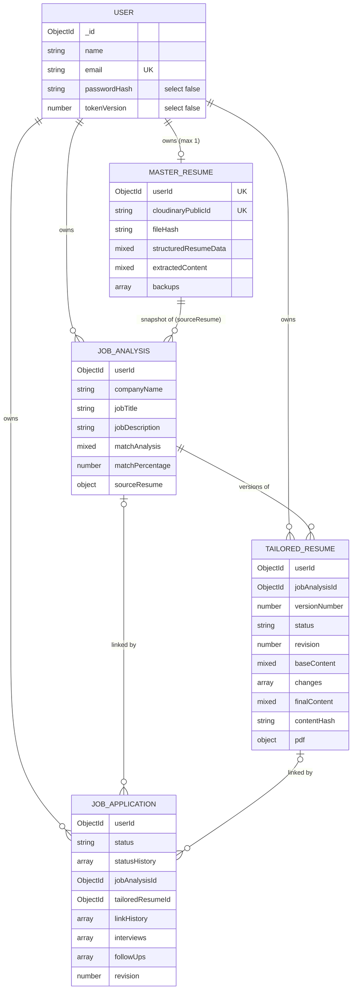

# 04 · Database design

MongoDB with Mongoose 9. Five collections, one model file each in `backend/models/`. All schemas use
`timestamps: true` (`createdAt`, `updatedAt`) and `versionKey: false` unless noted.

## Entity-relationship diagram

## User (`models/User.js`)

| Field | Type | Rules |
|---|---|---|
| `name` | String | required, trimmed, 1–100 |
| `email` | String | required, trimmed, lower-cased, ≤ 254, basic email pattern, **unique index** |
| `passwordHash` | String | required, `select: false` (never loaded unless asked) |
| `tokenVersion` | Number | default 0, `select: false`; incremented on logout |

`toJSON` exposes only `id`, `name`, `email`, `createdAt`. There is **no account deletion endpoint**;
users cannot be removed through the API.

## MasterResume (`models/MasterResume.js`)

| Field | Type | Rules / notes |
|---|---|---|
| `userId` | ObjectId → User | required, **unique index** (one master per user) |
| `originalFileName` | String | required, ≤ 255, sanitised (path and control characters removed) |
| `cloudinaryPublicId` | String | required, **unique index**; never returned by the API |
| `cloudinaryResourceType` / `cloudinaryDeliveryType` | String enums | `raw` / `authenticated` |
| `fileFormat` | enum `pdf` | |
| `fileSize` | Number ≥ 1 | |
| `fileHash` | String | SHA-256 hex (64 chars); used for integrity checks and staleness |
| `pageCount` | Number ≥ 1 | |
| `extractedContent` | Mixed | lines with style runs and coordinates, fonts, sizes, page info |
| `structuredResumeData` | Mixed | validated with the zod `structuredResumeSchema` on save |
| `templateId` | String / null | `classic-v1` when compatible |
| `templateCompatibility` | `{ compatible: Boolean, issues: [String] }` | issues contain no resume text |
| `extractorVersion` | String | `phase1-v1` |
| `uploadedAt` | Date | time of the current file |
| `backups[]` | sub-documents | previous PDFs: `cloudinaryPublicId`, `originalFileName`, `fileSize`, `fileHash`, `pageCount`, `uploadedAt`, `replacedAt` |

`minimize: false` keeps empty objects. Deleting the master resume deletes all backup files and the
current file first, then the record.

## JobAnalysis (`models/JobAnalysis.js`)

| Field | Type | Notes |
|---|---|---|
| `userId` | ObjectId → User | required |
| `companyName` ≤ 120, `jobTitle` ≤ 150, `jobDescription` ≤ 20,000 | String | required |
| `jobAnalysis` | Mixed | role summary, seniority, required experience, education, keyword groups, responsibilities, soft skills |
| `keywordAnalysis` | Mixed | must-have / preferred / optional keyword views and totals |
| `matchAnalysis` | Mixed | `requirements[]` (classification, evidence, relatedSkills, adjustments, decidedBy), `responsibilities[]`, `experience`, `score`, `warnings[]` |
| `matchPercentage` | Number 0–100 | denormalised for lists |
| `analysisVersion` | String | `phase4-v1` |
| `sourceResume` | `{ masterResumeId, fileHash, extractorVersion }` | which master resume file was analysed |
| `ai` | `{ provider, model, latencyMs, attempts }` | |

Index: `{ userId: 1, createdAt: -1 }`. Analyses are snapshots: replacing the master resume does not
rewrite them; the API derives `stale` by comparing `sourceResume.fileHash` with the current master.

## TailoredResume (`models/TailoredResume.js`)

| Field | Type | Notes |
|---|---|---|
| `userId`, `jobAnalysisId`, `masterResumeId` | ObjectId | required |
| `sourceResumeHash` | String (SHA-256) | master file the version was built from |
| `versionNumber` | Number ≥ 1 | per analysis |
| `status` | enum `draft`, `approved`, `pdf_ready` | |
| `revision` | Number | optimistic concurrency |
| `companyName`, `jobTitle` | String | copied from the analysis |
| `baseContent` | Mixed | master snapshot, never edited |
| `analysisSnapshot` | Mixed | requirements + responsibilities used for checks |
| `changes[]` | Mixed | proposals with `decision`, `validation`, `editedText`, `override`, `review`, `history[]` |
| `blocked[]`, `gaps[]` | Mixed | rejected AI proposals; missing keywords |
| `copiedFrom` | `{ versionNumber, tailoredResumeId }` | set by duplicate |
| `finalContent`, `contentHash`, `approvedAt`, `validationReport` | | set on approval |
| `pdf` | `{ cloudinaryPublicId, fileHash, fileSize, pageCount, templateId, generatedAt, validation }` | set when the PDF is stored |
| `ai` | `{ provider, model, latencyMs, attempts, repairRound }` | |
| `generatorVersion` | String | `phase5-v2` |

Indexes:
- `{ userId, jobAnalysisId, versionNumber }` **unique**;
- `{ userId, createdAt: -1 }`;
- `{ 'pdf.cloudinaryPublicId': 1 }` **unique, partial** (only when a string is present).

## JobApplication (`models/JobApplication.js`)

| Field | Type | Rules |
|---|---|---|
| `userId` | ObjectId → User | required |
| `companyName` (≤ 120), `jobTitle` (≤ 150) | String | required |
| `location` (≤ 150), `sourceDetail` (≤ 150), `notes` (≤ 5,000), `jobDescription` (≤ 20,000), `jobUrl` (≤ 2,048) | String | default `''` |
| `employmentType` | enum full_time, part_time, contract, internship, temporary, freelance, other, or null | |
| `salary` | `{ min ≥ 0, max ≥ 0, currency /^[A-Z]{3}$/, period year/month/hour }` | min ≤ max enforced by zod |
| `experience` | `{ minYears 0–60, maxYears 0–60, text ≤ 200 }` | |
| `source` | enum linkedin, naukri, indeed, company_website, referral, recruiter, other, or null | |
| `applicationDate` | Date / null | calendar date at UTC midnight |
| `status` | enum saved, applied, interview, selected, rejected, withdrawn | default saved |
| `statusHistory[]` | `{ from, to, kind: created/change/undo, note ≤ 500, applicationDateSet, at }` | append-only, ≤ 500 |
| `jobAnalysisId`, `tailoredResumeId`, `linkedAt` | ObjectId / Date | references, not copies |
| `linkHistory[]` | `{ jobAnalysisId, tailoredResumeId, versionNumber, linkedAt, unlinkedAt }` | append-only, ≤ 200 |
| `interviews[]` | `{ round, roundType, scheduledAt, durationMinutes 5–600, interviewer, meetingLink, notes, feedback, result, status, rescheduleHistory[{from,to,reason,at}], cancelledAt, cancelReason, createdAt, updatedAt }` | ≤ 20 rounds, ≤ 50 reschedules each |
| `followUps[]` | `{ dueDate, note ≤ 1,000, status pending/completed, completedAt, createdAt }` | ≤ 50 |
| `revision` | Number | optimistic concurrency |

Indexes (all start with `userId`):
`{status, updatedAt}`, `{applicationDate}`, `{createdAt}`, `{'followUps.dueDate'}`,
`{'interviews.scheduledAt'}`, `{jobAnalysisId}`, `{tailoredResumeId}`,
`{'linkHistory.jobAnalysisId'}`, `{'linkHistory.tailoredResumeId'}`.

### Why everything is embedded

Status history, link history, interviews and follow-ups belong to exactly one application and are
bounded in size. Embedding them means every change is **one atomic `findOneAndUpdate`** with a
`revision` guard – no multi-document transactions (which a standalone local MongoDB does not support)
and no orphaned child documents.

## How user ownership is enforced

1. Every document has `userId`.
2. Every service query includes `userId` from the verified JWT, e.g.
   `JobApplication.findOne({ _id: id, userId })`, `TailoredResume.findOne({ _id, userId })`.
3. Malformed ids and other users' ids both return **404**, so ids cannot be probed.
4. Cross-collection references are resolved inside the same user's data (e.g. linking an
   application to an analysis looks it up with `{ _id, userId }`).
5. Aggregations/exports start from a filter built with the user's id (`buildFilter`).
6. Tests cover cross-user access for every router (see [09-testing-strategy.md](09-testing-strategy.md)).

## Retention and deletion

| Action | What is deleted | What is kept |
|---|---|---|
| Replace master resume | nothing | old PDF moved to `backups[]` |
| Delete master resume | all backup files, current file, record | analyses, tailored versions, applications (snapshots) |
| Delete analysis | the analysis | blocked if tailored versions exist or an application references it |
| Delete tailored version | its PDF file, then the record | blocked if an application references it (now or in history) |
| Delete application | the application with its embedded history, interviews, follow-ups | linked analyses and versions |
| Logout | nothing | `tokenVersion` incremented |

There is no automatic expiry (TTL index) and no account deletion endpoint.
