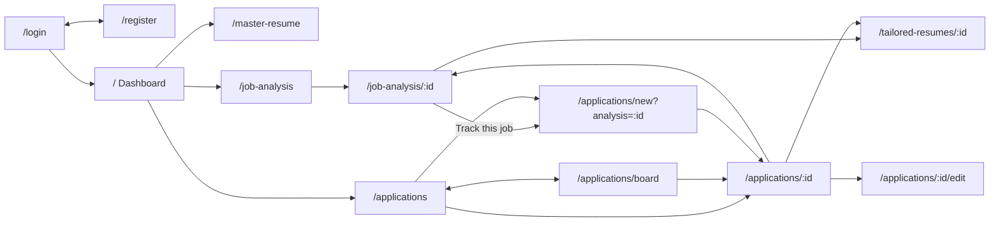

# 07 · Frontend architecture

React 19 SPA built with Vite 8 and Tailwind CSS 4, deployed to Netlify. Source: `frontend/src/`.

## Structure

```
src/
├── main.jsx                 providers: BackendStatusProvider → AuthProvider → App + Toaster
├── App.jsx                  route table (createBrowserRouter)
├── layouts/AppLayout.jsx    header, navigation, API status badge, sign-out, <Outlet/>
├── context/                 AuthContext (session), BackendStatusContext (health polling)
├── hooks/                   useBackendHealth, useMasterResume
├── services/                api.js (axios) + one file per backend area
├── pages/                   one component per route
├── components/              shared UI + feature folders (job-analysis, tailoring, applications)
└── utils/                   env.js (API URL), format.js, wordDiff.js
```

`src/store/` is empty (`.gitkeep`): no global state library is used.

## Routes and navigation

| Path | Page | Guard |
|---|---|---|
| `/login`, `/register` | `AuthPage` | guest only |
| `/` | `DashboardPage` (applications analytics, master resume, analyses, system status) | signed in |
| `/master-resume` | `MasterResumePage` | signed in |
| `/job-analysis` | `JobAnalysisPage` (form + history) | signed in |
| `/job-analysis/:id` | `JobAnalysisDetailPage` (score, requirements, tailoring section, "Track this job") | signed in |
| `/tailored-resumes/:id` | `TailoredResumePage` (review, approve, PDF) | signed in |
| `/applications` | `ApplicationsPage` (list, filters, CSV) | signed in |
| `/applications/board` | `ApplicationBoardPage` (Kanban) | signed in |
| `/applications/new`, `/applications/:id/edit` | `ApplicationFormPage` | signed in |
| `/applications/:id` | `ApplicationDetailPage` | signed in |
| `*` | `NotFoundPage` | – |



`RouteGuards.jsx`: `RequireAuth` shows a spinner while a stored session is verified and redirects
signed-out users to `/login` (remembering the original path); `GuestOnly` sends signed-in users to `/`.
`RouteErrorBoundary` renders route errors. Netlify's `/* → /index.html 200` rule makes deep links work.

## Authentication on the client (`context/AuthContext.jsx`)

- Session `{ token, expiresAt, user }` stored in `localStorage` under `arb.session` (expired sessions
  are discarded on read). The code documents the trade-off: readable by scripts on the origin (XSS),
  chosen because frontend and API are on different sites so cookies would be third-party.
- On load a stored session is **verified** with `GET /auth/me`; a 401 signs out, a network error
  (server waking up) keeps the session.
- `configureAuth()` gives the axios instance a token getter and a 401 handler that clears the session
  and shows "Your session has ended".
- `logout()` calls the API (revokes all tokens) and always clears the local session.

## API client (`services/api.js`, `utils/env.js`)

- `baseURL` = `VITE_API_URL` (build-time). `normalizeApiUrl` trims trailing slashes and appends `/api`
  to a bare origin; locally it defaults to `http://localhost:5000/api`. A production build without
  the variable shows a "misconfigured" state.
- Default timeout 30 s; longer per call for uploads (120 s), analysis (200 s), tailoring (240 s),
  PDFs/CSV (60 s).
- Response interceptor → `ApiRequestError { status, code, message, details, isNetworkError, isTimeout }`
  (it also parses JSON error bodies of `blob` responses).
- Feature services (`auth`, `masterResume`, `jobAnalysis`, `tailoredResume`, `jobApplication`,
  `health`) are the only modules that call axios. `jobApplication.service.js` adds the browser time zone
  (`tz`) to every call.

## State management

- **Server state** is fetched per page with `useEffect`/`useCallback` and kept in local `useState`
  (`{ status: 'loading' | 'ready' | 'error', data, error }` pattern).
- **Shared state** only via two contexts: authentication and backend health.
- **Optimistic concurrency**: pages keep the latest `revision` and send it as `expectedRevision`. On
  409 `REVISION_CONFLICT` they reload. `ApplicationDetailPage` queues actions so quick successive
  clicks each use the revision returned by the previous one.
- **URL state**: application list filters live in the query string (`useSearchParams`).

## Backend health and cold starts

`useBackendHealth` (shared through `BackendStatusContext`) polls `/api/health`: first attempt 8 s,
then retries every 3 s with 15 s timeouts for up to 90 s. Status: `checking`, `waking`, `online`,
`offline`, `misconfigured`. The header badge and the dashboard show it.

## Forms and validation

- Client-side checks are light and mirror the server (e.g. `AuthPage`: name required, email pattern,
  password ≥ 8; `JobAnalysisPage`: lengths and minimum description length).
- The server is authoritative: `VALIDATION_ERROR` details are mapped back to fields
  (`fieldErrors()` in `components/applications/meta.jsx`).
- `FormField` renders label, input, `aria-invalid` and the error message.

## Feature UIs

### Master resume (`MasterResumePage`, `FileDropzone`, `UploadProgress`, `PdfPreview`, `ResumeDetails`)
Drag-and-drop upload with progress; template compatibility status; PDF preview through an
authenticated fetch → `blob:` URL in an `<iframe>`; extracted content view; download via signed URL;
replace; delete with confirmation; list of previous versions (backups) with download.

### Job analysis (`JobAnalysisPage`, `JobAnalysisDetailPage`, `components/job-analysis/*`)
Form with elapsed-time indicator during the AI call; history list; detail page with `MatchScoreCard`
(score, breakdown, formula, disclaimer), requirements grouped by importance and classification with
evidence, related skills ("not the same, no credit") and adjustments; "Outdated" banner for stale
analyses; tailoring section to create and list versions.

### Resume approval workflow (`TailoredResumePage`, `components/tailoring/*`)
- `ChangeCard`: original vs proposed with a word-level diff (`utils/wordDiff.js`), explanation,
  targeted keywords, evidence, warnings; **review panel** (violet) with a confirmation checkbox for
  `review` issues; edit mode with override/review confirmations; recorded overrides and reviews.
- `OrderChangeCard`: skills/bullet order before and after.
- `ReviewPanels`: keyword coverage, gaps, layout report, blocked proposals.
- `PdfPanel`: approval state, PDF generation, validation results, preview and download.
- "Accept all suggestions (except those needing review)", approve, duplicate, delete.

### Application tracker (`Applications*Page`, `components/applications/*`)
- List with debounced search, status chips, location, source, date range, sorting, pagination, CSV.
- Board with native drag-and-drop, dimmed invalid columns, "Move to…" menu, undo toast.
- Detail: details and saved job description, interviews panel (add/edit/result/reschedule/cancel,
  reschedule history), follow-ups (add/complete/delete, overdue badges), status panel (allowed moves,
  optional note, undo, timeline), resume panel (linked analysis/version, outdated badges, PDF view and
  download, change links, link history).
- Form for create/edit; prefilled from an analysis with a selector of approved versions.

### Dashboard (`DashboardPage`, `DashboardApplications`)
Summary tiles, status bars, weekly/monthly SVG bar chart (with an accessible table), follow-ups,
upcoming interviews, recent applications; plus the master resume card, analysis card and system status.

## Loading, error and empty states

Every page renders explicit loading spinners, inline error boxes with "Try again" where reloading
helps, and empty states ("No applications yet…"). Toasts report results of actions.
404s on records show "does not exist or belongs to another account".

## Known frontend limitations

- One JavaScript bundle of about 560 kB (Vite warns above 500 kB); no route-level code splitting.
- No frontend unit tests; quality is checked by the production build and browser runs
  (see [09](09-testing-strategy.md)).
- The job-description form is not saved as a draft (the Phase 1 report suggested localStorage drafts;
  not implemented).
