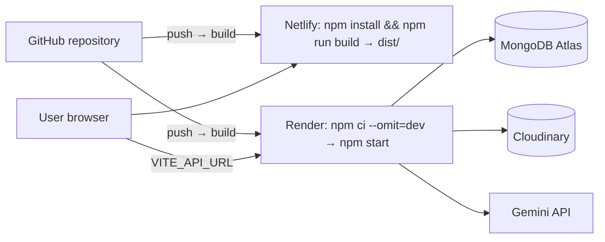

# 10 · Deployment guide

## Production topology

| Part | Where | URL |
|---|---|---|
| Source | GitHub | <https://github.com/prashanthkumarreddyA/CareerCraft-AI> |
| Frontend | Netlify (static build of `frontend/`) | <https://careercraft-ai-dash.netlify.app> |
| Backend | Render web service (root `backend/`) | <https://careercraft-ai-pmk4.onrender.com> |
| Database | MongoDB Atlas | connection string in `MONGODB_URI` |
| Files | Cloudinary (private raw assets) | account in `CLOUDINARY_*` |
| AI | Google Gemini API | key in `GEMINI_API_KEY` |

## Environment variables

### Backend (Render → Environment)

| Variable | Required in production | Default | Purpose |
|---|---|---|---|
| `NODE_ENV` | yes (`production`) | development | production mode (JSON logs, strict checks) |
| `PORT` | injected by Render | 5000 | HTTP port |
| `CLIENT_URL` | **yes** | localhost dev origins | allowed browser origin(s), comma-separated, **origin only** (e.g. `https://careercraft-ai-dash.netlify.app`) |
| `TRUST_PROXY` | recommended `1` | 1 in production | proxy hops (client IP for rate limits) |
| `LOG_LEVEL` | no | info | error / warn / info / debug |
| `RATE_LIMIT_WINDOW_MS`, `RATE_LIMIT_MAX` | no | 900000, 300 | general rate limit |
| `MONGODB_URI` | **yes** | – | Atlas connection string |
| `JWT_SECRET` | **yes** | random in dev | ≥ 32 characters |
| `JWT_EXPIRES_IN` | no | 7d | token lifetime |
| `BCRYPT_ROUNDS` | no | 12 | password hashing cost |
| `GEMINI_API_KEY`, `GEMINI_MODEL` | **yes** | – | Gemini key and model id |
| `GEMINI_FALLBACK_MODELS` | no | – | comma-separated fallback model ids |
| `GEMINI_THINKING_LEVEL` | no | – | LOW / MEDIUM / HIGH |
| `GEMINI_TIMEOUT_MS`, `GEMINI_TOTAL_TIMEOUT_MS`, `GEMINI_MAX_ATTEMPTS` | no | 90000, 170000, 3 | AI time budget |
| `CLOUDINARY_CLOUD_NAME`, `CLOUDINARY_API_KEY`, `CLOUDINARY_API_SECRET` | **yes** | – | file storage (key needs upload, destroy and download permissions) |
| `SIGNED_URL_TTL_SECONDS` | no | 300 | signed link lifetime |
| `MAX_UPLOAD_SIZE_MB` | no | 5 | upload limit |

Template: `backend/.env.example` (placeholders only).

### Frontend (Netlify → Site configuration → Environment variables)

| Variable | Value |
|---|---|
| `VITE_API_URL` | `https://<your-backend>.onrender.com/api` (a bare origin also works: `/api` is appended) |

`VITE_*` values are baked into the JavaScript at build time and are public: never put secrets here.

## Backend on Render

1. **New → Web Service** from the GitHub repository (or **New → Blueprint** using `render.yaml`).
2. Root directory `backend`; runtime Node; build `npm ci --omit=dev`; start `npm start`;
   health check path `/api/health`; Node version 22 (`NODE_VERSION=22` in the Blueprint).
3. Set the environment variables above (`render.yaml` marks secrets `sync: false`, generates `JWT_SECRET`).
4. Deploy. The log should show `API listening on port …` with
   `allowedOrigins: ["https://<your-site>.netlify.app"]`, then `MongoDB connected`.
5. Check `https://<your-backend>.onrender.com/api/health` →
   `"database": "connected", "ai": "configured"`.

Before deploying a new `GEMINI_MODEL`, run `npm run smoke:gemini` locally with the same key.
`npm run smoke:cloudinary` checks the Cloudinary account (private upload, signed URL, expiry, delete).

> The deployed Render service may have been created manually rather than from the Blueprint; the
> Blueprint's service name (`ai-resume-builder-api`) differs from the live host name. Settings above
> apply either way.

## Frontend on Netlify

1. **Add new site → Import from Git**, base directory **`frontend`**.
2. Build command and publish directory come from `frontend/netlify.toml`
   (`npm install && npm run build`, publish `dist`, Node 22).
3. Set `VITE_API_URL`.
4. Deploy. After changing `VITE_API_URL`: **Deploys → Trigger deploy → Clear cache and deploy site**.
5. SPA routing: `netlify.toml` redirects `/* → /index.html` (200), so `/applications/…` deep links work.
   It also sets security headers and long-term caching for `/assets/*`.

## MongoDB Atlas

Create a cluster and a database user, allow Render's outbound traffic in Network Access, put the
connection string (with a database name) into `MONGODB_URI`. Indexes are created by Mongoose on
start-up (`autoIndex`).

## Cloudinary

Use an API key that may upload, destroy and download. No upload preset or public delivery is needed:
the backend uploads `raw` assets with `type: authenticated`. Folders are created automatically
(`resumes/master/<userId>/`, `resumes/customized/<userId>/`).

## Redeployment

- Both services auto-deploy on push to the connected branch (Render `autoDeploy: true`).
- Changing backend env vars → Render redeploys/restarts the service.
- Changing `VITE_API_URL` → rebuild on Netlify (clear cache).

## Render free tier and cold starts

The free web service sleeps after inactivity; the first request can take up to about a minute. The
frontend polls `/api/health` for up to 90 s and shows "Waking server…". `/api/health` is not rate
limited and is not logged in production. The free instance has limited RAM; uploads are kept in
memory (≤ 5 MB) and PDFs are rendered in-process.

## Production troubleshooting

| Symptom | Likely cause | Fix |
|---|---|---|
| Requests go to `…onrender.com/auth/login` (404) | `VITE_API_URL` without `/api` on an older build | set `VITE_API_URL=…/api`, clear cache and redeploy |
| Browser: CORS error / 403 `CORS_ORIGIN_DENIED` | `CLIENT_URL` missing or not the exact Netlify origin | set `CLIENT_URL=https://<site>.netlify.app` (no path, no slash); check the start-up warning |
| Service exits at start with "… is required in production" | missing required variable | add it in Render |
| `/api/health` shows `database: connecting` | Atlas unreachable or IP not allowed | check `MONGODB_URI` and Atlas network access |
| 503 `AI_NOT_CONFIGURED` | `GEMINI_API_KEY` / `GEMINI_MODEL` missing | set both |
| 503 `AI_MODEL_UNAVAILABLE` | model id retired | `npm run smoke:gemini`, change `GEMINI_MODEL` / add fallbacks |
| 429 `AI_RATE_LIMITED` | Gemini quota | wait, or upgrade the quota |
| 502 `STORAGE_ERROR` / 503 `STORAGE_NOT_CONFIGURED` | Cloudinary credentials/permissions | `npm run smoke:cloudinary` |
| Users signed out after a deploy | `JWT_SECRET` changed | keep the secret stable |
| Deep link shows Netlify 404 | redirect rule missing | keep `frontend/netlify.toml` and base directory `frontend` |
| Dashboard shows "VITE_API_URL is not set" | variable missing at build | set it and rebuild |
